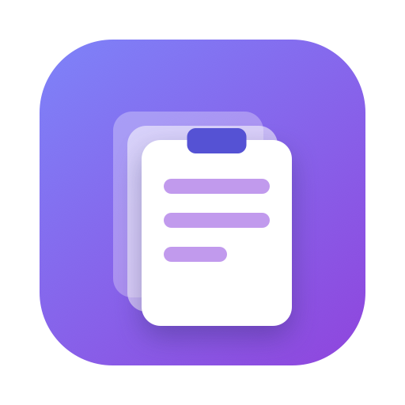

<p align="center"></p>
<h1 align="center">ClipStack</h1>
<p align="center">A tiny menu-bar clipboard history for macOS — like <code>Win+V</code>, but Mac-native.</p>

---

## Features

- **History that sticks** — your last 200 copied texts, saved across restarts
- **`⌘⇧V` anywhere** — search panel opens at your cursor: type to filter, `↑`/`↓` to pick, `Enter` pastes into the app you were in
- **Menu bar** — last 10 clips one click away, plus Clear History and Launch at Login
- **Privacy-aware** — clips that password managers mark as concealed (1Password etc.) are never recorded; history file is readable by your user only
- **Tiny and native** — one Swift file, zero dependencies, no Electron

## Install (build from source)

Needs the Xcode Command Line Tools (`xcode-select --install`). Then:

```bash
git clone <this-repo> && cd ClipStack
swift make-icon.swift      # generates the app icon
./build.sh                 # builds ClipStack.app
cp -R ClipStack.app /Applications/ && open /Applications/ClipStack.app
```

**First run:** macOS asks for Accessibility — turn ClipStack ON in
**System Settings → Privacy & Security → Accessibility**, then quit and reopen the app once.
Without it, picking a clip only copies it; it won't auto-paste.

## Usage

| Do this | What happens |
|---|---|
| Copy anything (`⌘C`) | Saved to history automatically |
| Press `⌘⇧V` | Search panel at your cursor — type, `↑`/`↓`, `Enter` to paste, `Esc` to close |
| Click the 📋 menu bar icon | Last 10 clips — click one to paste it |
| Menu → **Clear History** | Wipes everything |
| Menu → **Launch at Login** | Starts ClipStack automatically |

## How it works

- macOS has no clipboard-change notification, so ClipStack polls `NSPasteboard`'s `changeCount` every 0.5 s (negligible CPU).
- `⌘⇧V` is a Carbon `RegisterEventHotKey` global hotkey.
- Pasting puts the clip on the clipboard, then synthesizes a `⌘V` keystroke — this is the part that needs Accessibility.
- History lives at `~/Library/Application Support/ClipStack/history.json` (mode `0600`).

## Troubleshooting

- **Picks but doesn't paste** → Accessibility is off (or the app was rebuilt, which invalidates the old grant). Toggle ClipStack off and on in Accessibility, then quit and reopen it.
- **`⌘⇧V` does nothing** → another app owns that hotkey (ClipStack warns at launch). Use the menu bar icon, or change `hotKeyCode` in `main.swift` and rebuild.
- **Reset everything** → delete `~/Library/Application Support/ClipStack/history.json`.

## Repo layout

- [`main.swift`](main.swift) — the whole app
- [`build.sh`](build.sh) — builds and ad-hoc signs `ClipStack.app`
- [`make-icon.swift`](make-icon.swift) — draws the logo/icon in CoreGraphics
- [`Info.plist`](Info.plist) — bundle metadata
